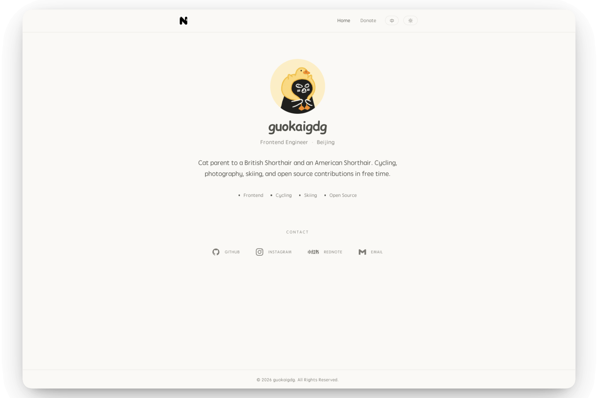

# GUOKAIGDG

    <a href="./README.zh-CN.md">简体中文</a> | <strong>English</strong> 

  

## Preview

Live site: <https://guokaigdg.github.io/home/>

## Font License

Latin text uses self-hosted [Allo](https://allo.joshpuckett.me) by Josh Puckett (SIL Open Font License 1.1); Chinese text falls back to system fonts. Font files and the license are in `assets/fonts/` — see [assets/fonts/README.md](assets/fonts/README.md).

## License

The source code is released under the [MIT License](LICENSE).

The site's payment QR code images may not be used for other purposes without permission.
