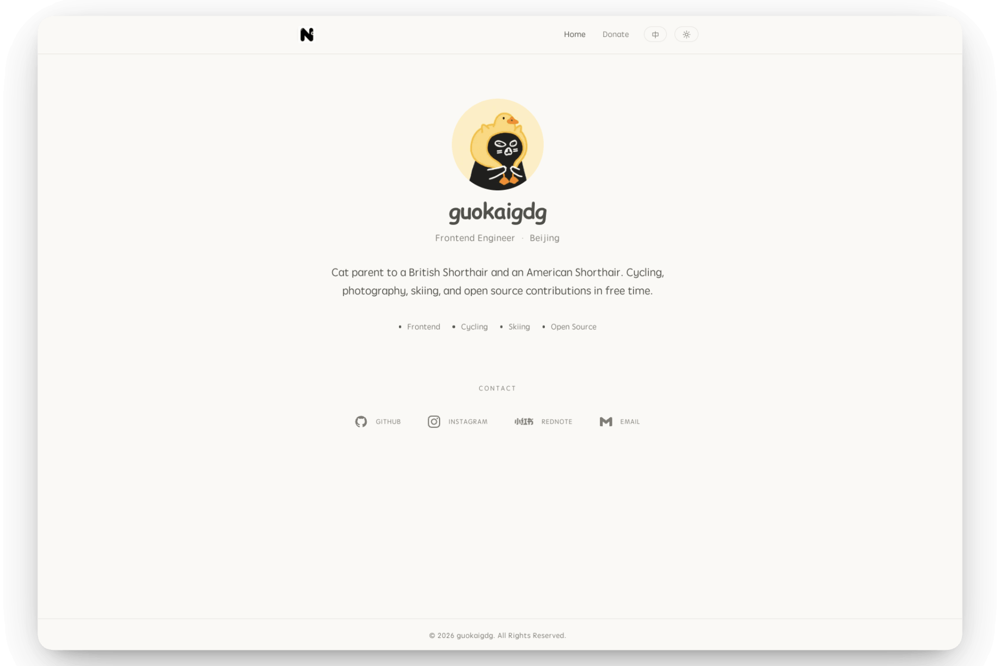

# GUOKAIGDG 的个人主页

  <strong>简体中文</strong> | <a href="./README.md">English</a>

  

线上地址：<https://guokaigdg.github.io/home/>

## 字体版权

- 乐米惠圆体：免费商用，来源 <https://font.leminet.cn/>，使用时请下载并保留免费商用授权书。
- Sniglet：开源字体，经 jsDelivr 加载 @fontsource/sniglet。

## 许可证

未经授权，请勿将本站收款码图片用于其他用途。其余代码版权归原作者所有。
